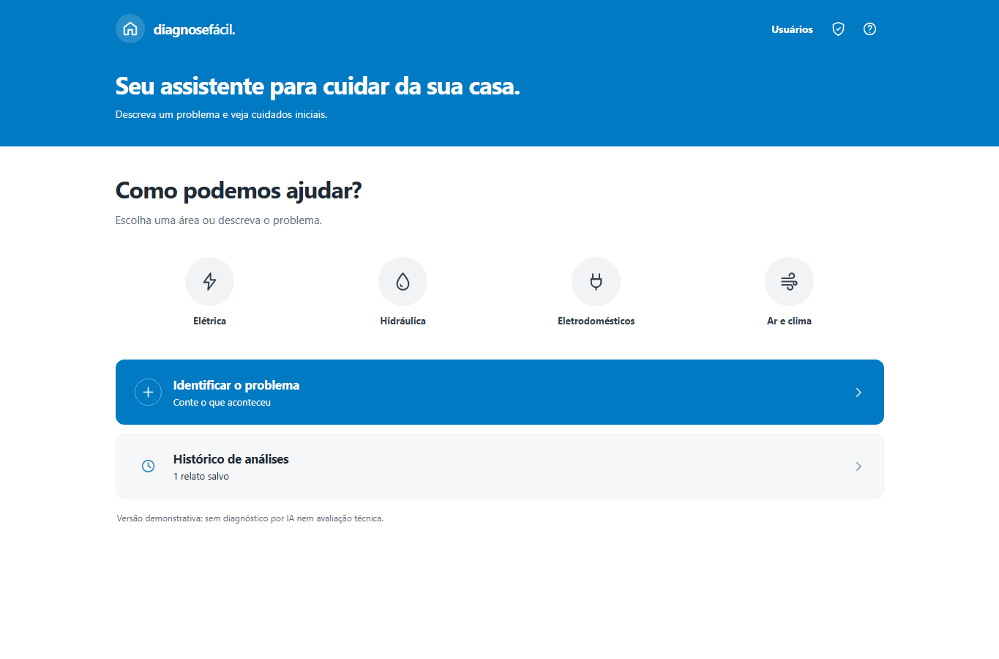
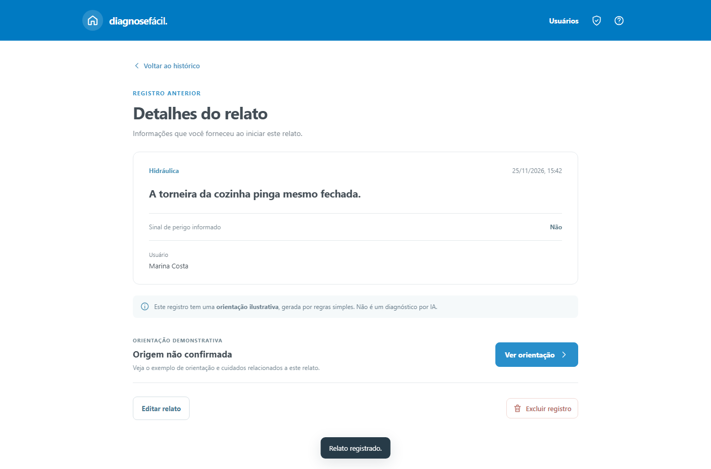
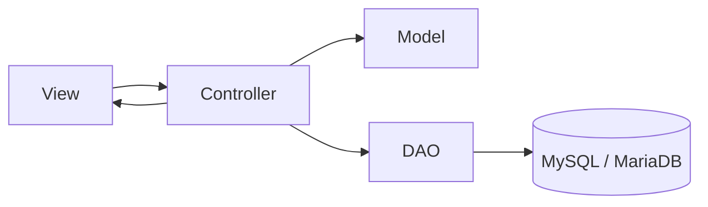

# DF System — DiagnoseFácil

Projeto integrador de Programação Orientada a Objetos (POO). O DiagnoseFácil é uma aplicação web para registrar problemas domésticos, identificar sinais de perigo e consultar orientações demonstrativas baseadas em regras simples. Não substitui uma avaliação profissional e não realiza diagnóstico por IA.

## Integrante

- Eduardo Prens Rota — RA: preencher antes da entrega.
- Curso: Análise e Desenvolvimento de Sistemas.

## Aplicação em funcionamento





## Tecnologias

PHP 8.2, HTML, CSS, JavaScript, PDO (extensões `pdo_mysql` e `mbstring`), MySQL ou MariaDB (InnoDB). Ambiente local recomendado: XAMPP. Não exige Composer nem npm.

## Instalação e execução

1. Instale o XAMPP com PHP 8.2 ou compatível e as extensões indicadas.
2. Extraia o projeto e copie a pasta `df_system` para `C:\xampp\htdocs\df_system`.
3. Inicie Apache e MySQL no painel do XAMPP.
4. Acesse [phpMyAdmin](http://localhost/phpmyadmin/) e importe `database/diagnose_facil.sql` em uma instalação nova. O script cria o banco `df_system` e suas duas tabelas. Se já houver um banco com esse nome, preserve os dados e confira se o schema corresponde ao script antes de reutilizá-lo.
5. Confira a conexão em `app/Config/Conexao.php`. A configuração local padrão usa `127.0.0.1:3306`, banco `df_system`, usuário `root` e senha vazia (padrão local do XAMPP). Para outra instalação, configure as variáveis de ambiente `DF_SYSTEM_DB_HOST`, `DF_SYSTEM_DB_PORT`, `DF_SYSTEM_DB_NAME`, `DF_SYSTEM_DB_USER` e `DF_SYSTEM_DB_PASSWORD`. Não publique senhas reais.
6. Abra [DiagnoseFácil](http://localhost/df_system/public/). Cadastre um usuário antes de registrar um problema. O painel administrativo de usuários e diagnósticos também está disponível em Ajuda.

## CRUD e relacionamento

| Tabela | Criar | Ler | Atualizar | Excluir |
|---|---|---|---|---|
| `usuario` | Nome, e-mail e telefone opcional | Listagem | Edição de cadastro | Exclusão sem diagnósticos vinculados |
| `diagnostico` | Relato associado a um usuário | Listagem, histórico e detalhes | Edição do relato ou vínculo | Exclusão do registro |

O relacionamento é 1:N: um usuário pode possuir vários diagnósticos. A chave estrangeira `diagnostico.id_usuario` referencia `usuario.id_usuario`. A aplicação impede excluir usuários que ainda possuam diagnósticos; exclua os relatos antes do cadastro. O SQL define `ON DELETE CASCADE` e `ON UPDATE CASCADE` para a chave estrangeira.

As telas incluem início, identificação, revisão, orientação, histórico, detalhes, segurança e ajuda. O histórico oferece busca, filtro e importação/exportação de JSON. O modo local, disponível em Ajuda, mantém dados no navegador e não substitui o CRUD integrado ao banco.

## Arquitetura e POO

```text
app/
  Config/         conexão PDO
  Models/         entidades Usuario e Diagnostico
  DAO/            persistência e consultas SQL
  Controllers/    validação e coordenação das operações
  Views/          telas e formulários
public/           entrada HTTP, CSS, JavaScript e interface local
database/        script SQL
docs/            capturas da aplicação
tests/           teste de integração CRUD
```

- Model: entidades com atributos privados, construtores, tipos e métodos de acesso.
- View: interface, formulários e listagens.
- Controller: recebe e valida dados, aplica regras e coordena o acesso aos DAOs.
- DAO: `UsuarioDAO` e `DiagnosticoDAO` concentram a persistência via PDO e implementam `RepositorioInterface`. O painel usa esse contrato para consultar os dois tipos de repositório, aplicando polimorfismo.



## Teste de integração

Com o banco importado e a conexão configurada, execute na raiz do projeto:

```bat
C:\xampp\php\php.exe tests\test_crud.php
```

O teste exige permissão para criar e apagar um banco temporário isolado. Ele verifica o CRUD das duas entidades, a chave estrangeira, validações e a preservação do banco original. Use uma instalação local de desenvolvimento.

## Transparência de IA

Eduardo definiu o escopo, a referência visual, o nome DF System e as decisões do projeto, além de gravar a demonstração. O ChatGPT/Codex auxiliou na integração das telas com PHP, na adaptação do banco, na organização MVC/DAO, nos testes, na documentação, no roteiro e na edição do vídeo. A apresentação utiliza narração sintetizada por IA. Não há registros suficientes para atribuir toda a implementação original exclusivamente ao aluno ou à IA. As orientações do aplicativo são geradas por regras simples, não por um modelo de IA.
